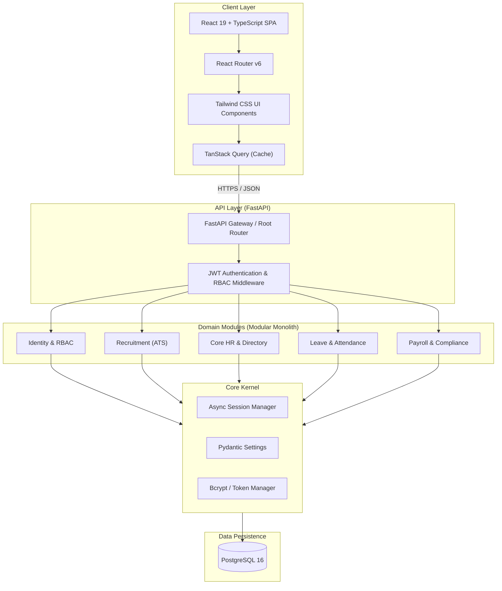

# System Architecture & Design: SproutWFS HR

## 1. Architectural Style: Modular Monolith
SproutWFS HR uses a **Modular Monolith** pattern. All modules reside in a unified codebase and share deployment orchestration, but remain cleanly decoupled through strict directory, schema, and interface boundaries.

### Advantages for SproutWFS HR:
* **Single Deployment Unit:** Low operational overhead during early and growth stages.
* **Strict Domain Isolation:** High cohesion within modules (Recruitment, Employees, Payroll, Leave) without microservice network latency or distributed transaction complexities.
* **Extraction Path:** Any module can be separated into an independent service if organizational scaling requires it.

---

## 2. System Architecture Diagram

---

## 3. Module Boundaries & Communication Rules

### Internal Module Layout
Every module inside `backend/app/modules/<module_name>/` adheres to the following structure:
* **`models.py`:** SQLAlchemy ORM models inheriting from `app.core.database.Base`.
* **`schemas.py`:** Pydantic models for incoming requests and outgoing responses.
* **`service.py`:** Domain business logic, calculations, and persistence transactions.
* **`router.py`:** HTTP route declarations with dependency injection for authentication and database sessions.

### Boundary Rules
1. **No Cross-Module Database Queries:** Module A must never directly query Module B's SQLAlchemy tables.
2. **Service Interface Calls:** If Recruitment needs employee data, it queries the `EmployeeService` public interface.
3. **Database Transactions:** The database connection is injected via FastAPI's `Depends(get_db)`. Each HTTP request operates within its own transactional boundary.

---

## 4. Security & Data Protection Architecture

* **Authentication:** OAuth2 Password Bearer flow issuing signed JSON Web Tokens (JWT).
* **Password Hashing:** Passlib with Bcrypt (cost factor 12).
* **Role-Based Access Control (RBAC):**
  * Route-level permission guards using FastAPI dependencies (`require_role(["HR_MANAGER", "SUPER_ADMIN"])`).
* **Cross-Origin Resource Sharing (CORS):** Strict origin whitelisting in `app.core.config.Settings`.
* **Input Validation:** Strict type enforcement via Pydantic v2 prevents SQL injection, type coercion bugs, and parameter tampering.
